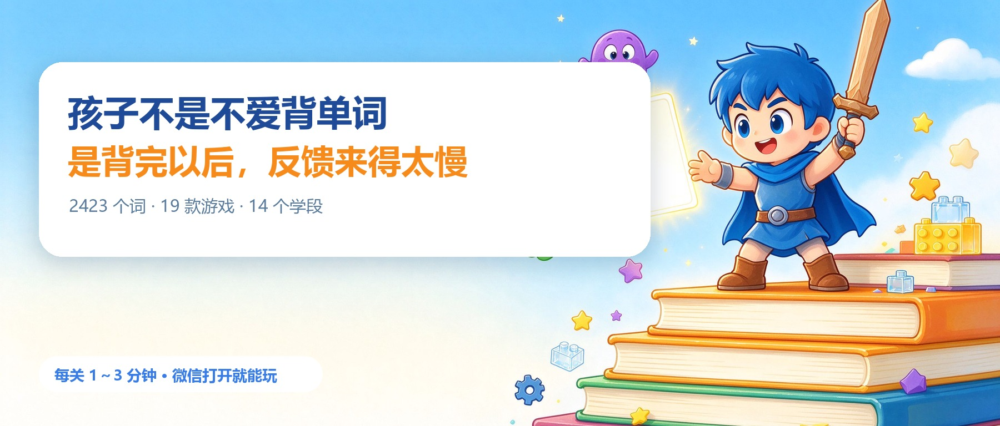
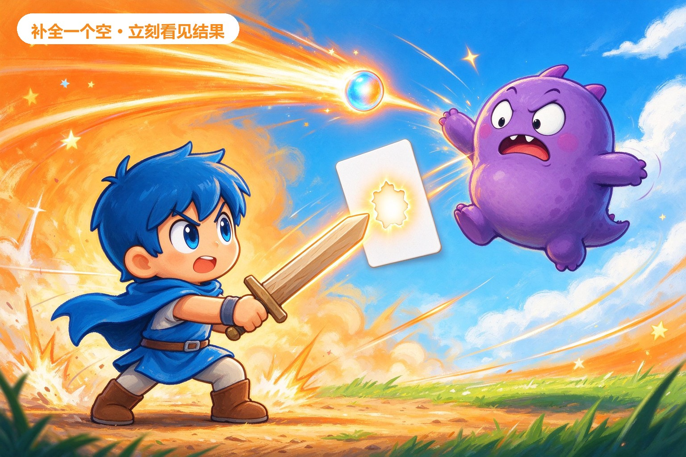
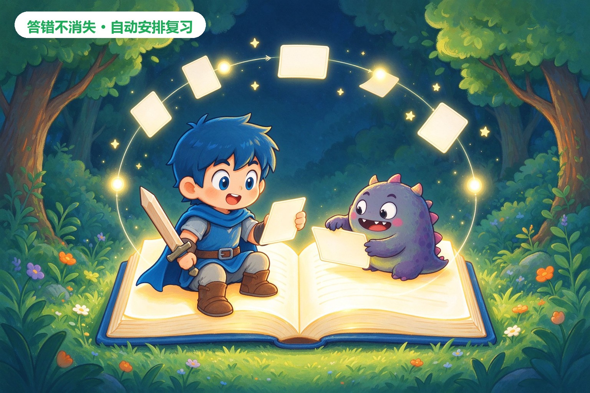
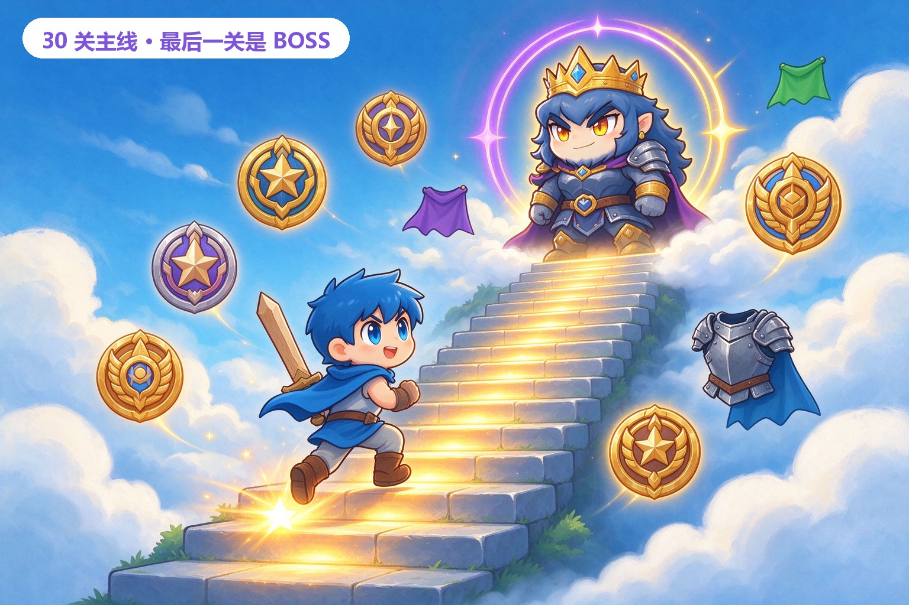

# 别再逼孩子“坐好背单词”了，他缺的可能不是自律

> 微信公众号 / 小红书长文通用稿 · 2026-10-21  
> 副标题：我们把 2423 个词做进了 19 款游戏，每关 1～3 分钟；从幼儿园到大学，微信打开就能玩。  
> 配图：`docs/wechat-article-20261021/`（由豆包生成，正文文字另行排版）

---

先别急着催。

很多家庭都经历过同一个晚上：

单词表摊开半小时，孩子还在第一页；
一说“再背十个”，立刻口渴、困了、想上厕所；
可一打开游戏，精神比谁都好。

我们后来才想明白：**孩子不是天然讨厌学习，而是讨厌“学了半天，不知道有没有用”的感觉。**

背完一个词，要等到第二天听写、下一次考试，才知道自己记住没有。

游戏为什么让人停不下来？

因为点一下，怪兽掉血；
连对三次，星星亮起；
再差一点就能过关，手会自己点“再来一局”。

所以「词力战士」只做了一件事：

**把单词、词语、成语和数学题，变成看得见结果的闯关。**

而且尽量做到——打开微信，不用下载，先玩一关再说。

---

## 一、把“补全”变成“命中”

字母射击是最好懂的一款。

屏幕上方是怪兽和一张缺了内容的词卡，下方是可选答案。

选对，小战士立刻出招，怪兽后退；
选错，怪兽会逼近一格，正确答案同时亮出来。

每关只有 10 题，大约 1～2 分钟。

这个长度很关键。

它短到孩子愿意“再来一关”，又长到足够完成一次有效的集中练习。

答对不是静悄悄地换下一题，而是有爆炸、有连击、有星星；
答错也不是一顿批评，而是马上看见正确答案，再继续。

我们刻意保留了“打怪”的热闹，但没有把它做成血腥战斗：

怪兽是圆滚滚的，打中是击退，不是伤害；
题目永远服务于“补对内容”，而不是让操作本身抢走注意力。

**孩子以为自己在玩，实际上每一次点击都在完成一次回忆、判断和纠错。**

---

## 二、同一批词，换 19 种方式打开

同一个孩子，今天喜欢打怪，明天可能只想安安静静拼词。

所以同一套题库，目前做了 **19 款已开放玩法**。

其中 7 款专门练字词，每款都有 **30 关**：

| 玩法 | 怎么玩 | 适合什么状态 |
| --- | --- | --- |
| 字母射击 | 补全缺失的字母或汉字，打退怪兽 | 需要即时反馈、坐不住 |
| 词义消消乐 | 词卡和释义配对消除 | 喜欢配对、找规律 |
| 词语连连看 | 连线匹配词和释义 | 喜欢安静思考 |
| 字母拼词工坊 | 看中文，把字母拼成英文单词 | 练拼写 |
| 成语拼字 | 看释义，从字块里拼出成语 | 积累语文词汇 |
| 单词贪吃蛇 | 吃对词，避开干扰项 | 喜欢经典游戏 |
| 限时抢答 | 倒计时里快速选词，答错扣时间 | 已经背过一轮，练反应 |

另外 12 款偏数字与脑力，换的是思考方式：

算 24 点、算式天平、口算冲刺、数独、记忆矩阵、一笔画、华容道、2048、找规律、认钟表、词义迷宫、汉诺塔。

一局有明确结束点，不用一直坐在那里：

口算冲刺 60 秒；
字母射击、词义消消乐、连连看大约 1 分钟；
数独、华容道、2048 通常 3～10 分钟；
每一款玩法入口都标了预计时长，先决定今天有没有时间，再开始。

**重要的不是“玩法多”，而是孩子可以换口味，却不用换一套学习记录。**

今天玩射击，明天换贪吃蛇，星星、段位、错题和报告都在同一份进度里。

---

## 三、不是“一套题换个年级名字”

词力战士目前覆盖 **14 个学段**：

幼儿园、小学一到六年级、初一、初二、初三、高一、高二、高三、大学。

内置题库 **2423 条**，包含英语单词、词语、成语、歇后语、组词、英语句填空和中英互译等类型。

英语词条带 **IPA 音标**；小学阶段可选 **人教版 PEP / 外研版 / 通用词表**，不同年级有各自对应的词库。

第一次进入时先选年级，之后可以随时切换。

年级不是摆设：主线、自由玩、词库、每日挑战和好友 PK 都会跟着当前年级取题，各年级进度独立保存。

如果孩子今天只想复习三年级，不会被高年级词条突然打断；
如果已经升年级，也不用从头再来。

游客可以先试前 3 关。

先看孩子吃不吃这一套，再决定要不要注册，比先让家长做一堆设置更重要。

---

## 四、30 关一条主线，最后一关留给 BOSS

每个学段都有一条 **30 关主线**。

第 1 关固定是字母射击，先学基本操作；
中间轮换不同玩法，难度随着年级和关卡推进；
第 30 关是 Boss 关：15 道题、7 条命、专属立绘和更大的挑战感。

每关按正确率给 1～3 星：

90% 及以上是 3 星；
70% 及以上是 2 星；
60% 及以上是 1 星。

上一关至少拿到 1 星，才会解锁下一关。

这套规则看似严格，实际是在保护“会了再往前走”的节奏。

**如果只靠点得快就能通关，星星就没有意义；如果错太多也能随便解锁，孩子很快会学会糊弄。**

所以我们不追求把孩子哄开心一分钟，而是希望他每次过关，都真的比上一关多会一点。

---

## 五、错题不是惩罚，是下一次出题的线索

很多学习产品会把错题做成红色警告，像是在提醒孩子“你不行”。

我们更愿意把错题当作一份路线图。

答错的题会自动进入错题本，再按照 **艾宾浩斯遗忘曲线** 安排复习：

第 1 天、2 天、4 天、7 天、15 天、30 天。

连续答对 6 次，才会进入“已掌握”。

错题本可以搜索、分页，也能按“待复习 / 已复习 / 已掌握”筛选。

复习完成后，是移出错题本，还是继续保留，由孩子自己决定。

学习报告则告诉家长更关键的事：

这几天答了多少题；
正确率有没有变化；
哪类题型更薄弱；
哪个玩法练得最多。

家长不用一直站在身后盯着，也能知道该在哪里帮一把。

---

## 六、奖励不靠“点一下送金币”

游戏化学习最容易失效的设计，是奖励来得太快。

随便点点就送金币，孩子两天就腻；
什么都用钱买，又会把“变强”变成“充值”。

词力战士的做法是：

**用星星推进段位，用段位和成就解锁形象。**

当前版本有：

- 9 个大段位、共 81 个小级，从青铜一路到学神；
- 48 套战士与怪兽形象，靠段位、成就等长期目标解锁；
- 51 个成就，覆盖累计答题、玩法通关、连续练习、错题复习和自定义题库等方向；
- 总榜和分玩法进度榜，能看到自己排第几，也能看到别人玩到哪；
- 双月赛季、每日挑战和好友 PK，给已经形成习惯的孩子一个短期目标。

皮肤不是付费加速道具。

我们更希望孩子记住的是：

**“我今天又多走了两格，是因为我真的练了。”**

而不是“我充了钱，所以看起来更厉害”。

---

## 七、课本上的词，也能直接加进去

内置词库再全，也不可能覆盖每个家庭的具体进度。

所以词力战士还做了自定义题库。

家长可以新建题库、挂在对应年级下，添加或编辑词条，设定题目、答案、提示和干扰项。

保存后，它会和该年级内置词库一起参与闯关出题。

今天老师听写了 15 个词，晚上就能把它们变成一关；
孩子总把某几个词弄混，也可以单独整理出来，反复练。

这件事看起来不“炫”，却是很多家长最需要的：

**不是再给我一套通用内容，而是让我把孩子真正要学的内容放进去。**

---

## 八、我们刻意没做的三件事

游戏化学习最大的风险，是游戏压过学习。

所以有几条边界，我们一直保留：

1. **不做无限时长。** 每局都有明确题数和结束点，玩完就结束。
2. **不做付费变强。** 形象和段位不卖加速包，进度只能靠练习积累。
3. **不做社交聊天。** 可以看榜、可以和好友 PK，但不做私信和好友聊天，避免注意力跑偏。

我们也不觉得一款游戏能替代老师和家长。

它更适合做一件小事：

**把每天那 10 分钟，从“催着背”变成“愿意练”。**

---

## 最后

如果你家孩子也正在经历这些：

单词背了就忘；
成语只会读不会写；
口算一坐就烦；
说了很多次“再坚持一下”，最后还是家长先着急。

可以先让他玩一关。

不用下载，微信搜索小程序 **「拾光手记小栈」**，或者识别文末小程序码。

今天不用定一个特别大的目标。

就从一关开始。

如果你愿意，也欢迎在后台告诉我们：

**你家孩子最容易在哪一类题上“卡住”？**

我们会继续把真实的学习难题，做成下一次更新。

---

## 发布说明（给运营，不用发出去）

### 标题备选

1. 别再逼孩子“坐好背单词”了，他缺的可能不是自律
2. 孩子背了就忘？我们把 2423 个词做成了 19 款游戏
3. 从幼儿园到大学：每关 1 分钟，让孩子愿意主动再来一关
4. 不靠金币，不靠充值，孩子为什么会主动想闯下一关？
5. 错题不是红色警告，而是一条“下一次练什么”的路线

### 配图顺序

| 序号 | 图片 | 放置位置 |
| --- | --- | --- |
| 01 | `01-cover.jpg` | 封面；已叠加标题 |
| 02 | `02-battle.jpg` | 第一节标题下 |
| 03 | `03-modes.jpg` | 第二节标题下 |
| 04 | `04-growth.jpg` | 第六节前或“段位与成长”段落旁 |
| 05 | `05-review.jpg` | 第五节开头 |
| 06 | `06-qr.jpg` | 文末扫码引导 |

### 使用前检查

1. 小程序码必须使用真实后台生成的图，不要用 AI 生成或手绘替代。
2. 文章里的数字对应 2026-10-21 当前代码口径；发布前若版本已变，再核对一次。
3. 插画只负责氛围和故事，标题与卖点由排版文字承担，不要把长文案塞进图片。
